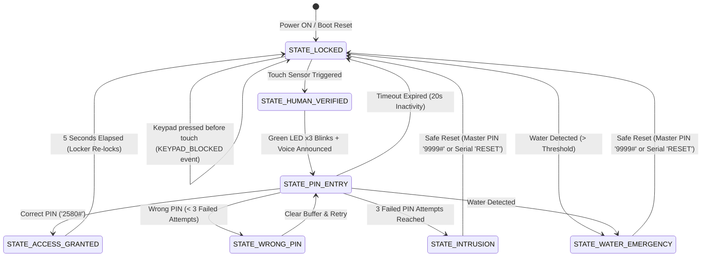

# 📐 Intelligent Smart Locker & Anti-Theft Security System — System Architecture

## 1. Overview & High-Level Architecture

The **Intelligent Smart Locker** is a multi-tier embedded physical security system controlled by an **Arduino UNO** and synchronized via **bidirectional USB Serial** with an offline **Python Voice & Security Assistant** running on a host laptop.

The system ensures robust security by implementing:
- **Two-Stage Authentication:** Touch-based human-presence verification followed by a 4×4 Matrix Keypad PIN.
- **Strict Default-Lock Principle:** The locker remains locked under all unverified conditions, including power-on, motion, water, or malformed input.
- **Three-Attempt Lockout Protection:** Triggers danger lockout after 3 consecutive incorrect PIN entries.
- **Liquid/Emergency Detection:** Analog water sensor with multi-sample confirmation.
- **Multimodal Feedback:** Dual-status LEDs (Green/Red), active piezoelectric buzzer sirens, and synthesized vocal announcements via laptop speakers.

```
+-----------------------------------------------------------------------------------+
|                                  PHYSICAL LOCKER                                  |
|                                                                                   |
|   +-----------------------+     +-----------------------+     +---------------+   |
|   | Touch Sensor (TTP223) |     | 4x4 Membrane Keypad   |     | Water Sensor  |   |
|   +-----------+-----------+     +-----------+-----------+     +-------+-------+   |
|               |                             |                         |           |
|               +--------------------+        |        +----------------+           |
|                                    |        |        |                            |
|                                    v        v        v                            |
|                             +-------------------------------+                     |
|                             |      ARDUINO UNO R3           |                     |
|                             |   (Finite State Machine)      |                     |
|                             +---------------+---------------+                     |
|                                    |        |        |                            |
|               +--------------------+        |        +----------------+           |
|               |                             |                         |           |
|               v                             v                         v           |
|   +-----------+-----------+     +-----------+-----------+     +-------+-------+   |
|   | SG90 Micro Servo Lock |     | Green & Red LEDs      |     | Active Buzzer |   |
|   +-----------------------+     +-----------------------+     +---------------+   |
+---------------------------------------------|-------------------------------------+
                                              | USB Serial (9600 Baud)
                                              v
+-----------------------------------------------------------------------------------+
|                             LAPTOP VOICE ASSISTANT                                |
|                                                                                   |
|  [pyserial Reader Thread] -> [Thread-Safe Speech Queue] -> [pyttsx3 Offline TTS]  |
|                                                                                   |
|  * Real-Time Voice Warnings: "Accurately human detected", "Access granted"        |
|  * Admin Console & Timestamped Security Logging (`security_events.log`)           |
+-----------------------------------------------------------------------------------+
```

---

## 2. Finite State Machine (FSM)

The firmware runs a deterministic, non-blocking Finite State Machine. The system can only reside in one well-defined state at any given clock tick:



---

## 3. Comprehensive State Definitions & Transitions

| State Name | Servo Angle | Green LED | Red LED | Buzzer | Allowed Actions & Trigger Events | Next State |
| :--- | :--- | :--- | :--- | :--- | :--- | :--- |
| `STATE_LOCKED` | $0^\circ$ (Locked) | OFF | OFF | OFF | System boots into this state. Keypad entries rejected with `KEYPAD_BLOCKED`. Touch triggers transition. | `STATE_HUMAN_VERIFIED` on touch |
| `STATE_HUMAN_VERIFIED` | $0^\circ$ (Locked) | Blinks 3× | OFF | OFF | Emits `HUMAN_DETECTED` to Python. Green LED flashes 3 times. Sets up PIN buffer. | `STATE_PIN_ENTRY` |
| `STATE_PIN_ENTRY` | $0^\circ$ (Locked) | OFF | OFF | Chirp on key | Accepts digits `0-9, A-D`. `*` clears buffer. `#` submits PIN. 20-second inactivity watchdog. | `STATE_ACCESS_GRANTED` (Correct) / `STATE_WRONG_PIN` (Wrong) / `STATE_LOCKED` (Timeout) |
| `STATE_ACCESS_GRANTED` | $90^\circ$ (Open) | ON (Solid) | OFF | Short Beep | Emits `ACCESS_GRANTED` and `LOCKER_OPEN`. Non-blocking 5-second countdown timer runs. | `STATE_LOCKED` after 5000 ms |
| `STATE_WRONG_PIN` | $0^\circ$ (Locked) | OFF | 2× Flash | Warning Beep | Emits `WRONG_PASSWORD`. Increments `passwordAttempts`. If attempts $\ge 3$, lock out! | `STATE_PIN_ENTRY` (if < 3) / `STATE_INTRUSION` (if $\ge 3$) |
| `STATE_INTRUSION` | $0^\circ$ (Locked) | OFF | Rapid Strobe | Fast Siren | Emits `THREE_ATTEMPTS`. Total hardware lockout. | `STATE_LOCKED` on Safe Reset |
| `STATE_WATER_EMERGENCY` | $0^\circ$ (Locked) | OFF | Rapid Strobe | High-Pitch Siren | Emits `WATER_DANGER`. Immediate danger lockout. | `STATE_LOCKED` on Safe Reset |

---

## 4. Hardware Pinout & Wiring Specifications

### 4.1 Master Pin Assignment Table (Arduino UNO)

| Pin | Type | Connected Module | Module Pin | Description & Wiring Notes |
| :--- | :--- | :--- | :--- | :--- |
| **D0 (RX)** | Digital | USB Serial | — | Reserved for Serial communication to PC (DO NOT CONNECT) |
| **D1 (TX)** | Digital | USB Serial | — | Reserved for Serial communication to PC (DO NOT CONNECT) |
| **D2** | Digital | 4×4 Keypad | Pin 8 (Col 4) | Keypad column 4 ('A', 'B', 'C', 'D') |
| **D3** | Digital | 4×4 Keypad | Pin 7 (Col 3) | Keypad column 3 ('3', '6', '9', '#') |
| **D4** | Digital | 4×4 Keypad | Pin 6 (Col 2) | Keypad column 2 ('2', '5', '8', '0') |
| **D5** | Digital | 4×4 Keypad | Pin 5 (Col 1) | Keypad column 1 ('1', '4', '7', '*') |
| **D6** | Digital | 4×4 Keypad | Pin 4 (Row 4) | Keypad row 4 ('*', '0', '#', 'D') |
| **D7** | Digital | 4×4 Keypad | Pin 3 (Row 3) | Keypad row 3 ('7', '8', '9', 'C') |
| **D8** | Digital | 4×4 Keypad | Pin 2 (Row 2) | Keypad row 2 ('4', '5', '6', 'B') |
| **D9** | Digital | 4×4 Keypad | Pin 1 (Row 1) | Keypad row 1 ('1', '2', '3', 'A') |
| **D10** | PWM Out | SG90 Servo Motor | Orange / Yellow (PWM) | Micro servo bolt actuator ($0^\circ$ locked, $90^\circ$ open) |
| **D11** | Digital Out | Active 5V Buzzer | (+) Anode | Active buzzer positive lead (Cathode to GND) |
| **D12** | Digital In | Touch Sensor (TTP223) | I/O / SIG | Active-HIGH digital output on touch contact |
| **A0** | Digital Out | Green Status LED | (+) Anode | Series with $220\ \Omega$ to $330\ \Omega$ resistor |
| **A1** | Digital Out | Red Danger LED | (+) Anode | Series with $220\ \Omega$ to $330\ \Omega$ resistor |
| **A2** | Unassigned | None | — | Unassigned / Free for future expansion |
| **A3** | Analog In | Water Level Sensor | SIG / S | Analog trace grid voltage divider ($0-1023$) |
| **5V** | Power | All Modules VCC | VCC / (+) | Breadboard positive power rail |
| **GND**| Power | All Modules GND | GND / (-) | Common ground rail (Arduino GND connected to breadboard) |

> [!IMPORTANT]
> **Power Supply Best Practice for SG90 Servo:**
> While an SG90 can be powered from the Arduino UNO 5V rail during basic testing, servos can draw transient surge currents up to $500\text{ mA}$ during rapid movement. If you experience random Arduino resets when the servo turns, connect a $100\ \mu\text{F} - 470\ \mu\text{F}$ electrolytic capacitor across the 5V and GND power rails on your breadboard.

---

## 5. Sensor Filtering & Tamper Detection Algorithms

### 5.1 Water Sensor Noise Rejection
The water sensor analog grid can capture electromagnetic induction spikes from nearby AC appliances. To prevent spurious alarms:
1. **Periodic Sampling:** Analog voltage is read at discrete $60\text{ ms}$ intervals.
2. **Threshold Check:** Voltage must read $A_{\text{in}} \ge 350$ (on a $0-1023$ scale).
3. **Consecutive Confirmation:** The reading must exceed the threshold for **3 consecutive intervals** ($180\text{ ms}$ total sustained wetness) before transitioning to `STATE_WATER_EMERGENCY`.

> [!NOTE]
> **Important Clarification on Sensor Roles:**
> - **Touch Sensor:** Detects physical skin contact with the capacitive electrode. In documentation and UI, this is designated as **"Touch-based human-presence verification"**, not biometric authentication.
> - **Water Sensor:** Detects moisture and liquid contact across sensor traces. This is treated as a **tampering/environmental emergency detection mechanism**, not an electrical short-circuit detector. Never purposefully short power rails.

---

## 6. Serial Communication Protocol

All messages transmitted between the Arduino UNO and the Python application are standard ASCII strings terminated by newline (`\n`):

### 6.1 Arduino $\rightarrow$ Laptop Events

| Event Name | Meaning | Laptop Voice Synthesis Response |
| :--- | :--- | :--- |
| `SYSTEM_STARTED` | Arduino booted and locked | "Smart locker system initialized and secured." |
| `HUMAN_DETECTED` | Touch sensor presence confirmed | "Accurately human detected." |
| `KEYPAD_BLOCKED` | Keypad pressed before touch | "Please ensure you are human." |
| `WRONG_PASSWORD` | Incorrect PIN entered | "Invalid password." |
| `ACCESS_GRANTED` | Correct PIN entered | "Access granted." |
| `LOCKER_OPEN` | Servo moved to $90^\circ$ | "Locker opened." |
| `LOCKER_LOCKED` | Servo moved to $0^\circ$ | "Locker locked." |
| `THREE_ATTEMPTS` | 3 consecutive bad PINs | "Invalid user. Danger signal is detected." |
| `INTRUSION_VIBRATION` | Tamper/shock detected | "Chorrr Chorrr Danger!" |
| `WATER_DANGER` | Water detected on sensor | "Throwing water... Danger Danger." |
| `ALARM_RESET` | Alarm safely disarmed | "Security alarm reset. System is now locked." |

### 6.2 Laptop $\rightarrow$ Arduino Commands

| Command | Action | Arduino Response |
| :--- | :--- | :--- |
| `RESET` / `ALARM_RESET` | Disarms `INTRUSION` or `WATER_EMERGENCY`, resets attempts to 0 | Emits `ALARM_RESET`, locks servo |
| `UNLOCK` | Administrative remote unlock override | Emits `ACCESS_GRANTED`, opens servo for 5s |
| `LOCK` | Administrative remote lock override | Emits `LOCKER_LOCKED`, locks servo |
| `STATUS` | Requests live telemetry | Returns `STATE:<state> \| ATTEMPTS:<n>` |
